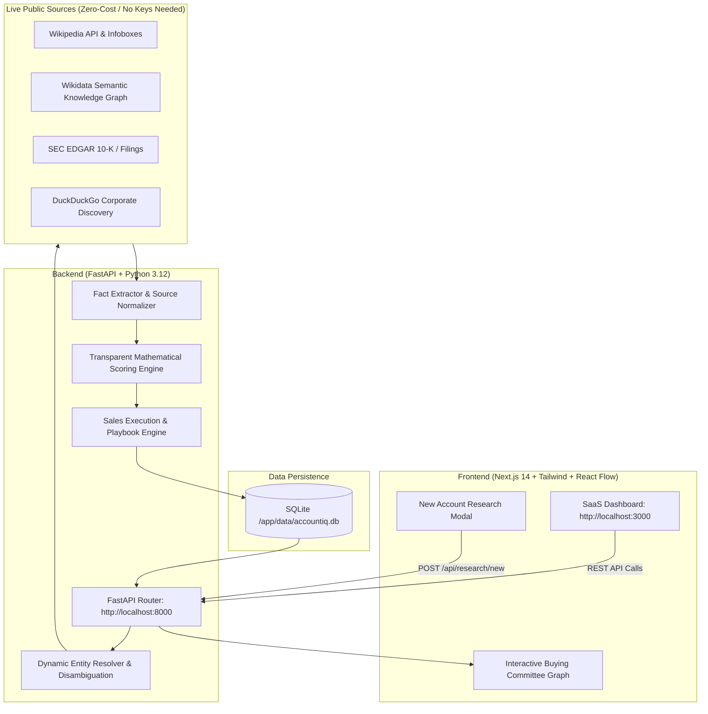

# AccountIQ — Enterprise Account & Contact Intelligence Platform for Zscaler
**Account and Contact Intelligence POC by Sahaj Khunteta**  
*Target Evaluation: Sahaj | Assignment Requirement: "A repo we can run with one setup command"*  
*Primary Account: Siemens AG (Expansion Opportunity) + Universal Dynamic Engine for Any Enterprise*

---

## 📖 Master Documentation
> 🌟 **[Comprehensive Master Guide: ACCOUNTIQ_COMPLETE_DOCUMENTATION.md](file:///C:/Users/d9f6t/OneDrive/Desktop/BridgeAI.ai/docs/ACCOUNTIQ_COMPLETE_DOCUMENTATION.md)**  
> Complete reference covering the original business problem, architectural design, 7 enterprise screens, scoring mathematical models, dynamic entity extraction, 27 automated tests, and a timed demo walkthrough.

---

## 🚀 One-Command Launch (Recommended: Docker Compose)

The easiest and most reliable way to evaluate AccountIQ is using **Option 2: Docker Compose**. This automatically builds the backend and frontend containers, installs dependencies, mounts persistent storage for the database, runs health checks, and connects all networking with a single command.

### Prerequisites
- [Docker Desktop](https://www.docker.com/products/docker-desktop/) installed and running (with Compose v2+)
- `git`

### One-Command Setup

```bash
# 1. Clone the repository
git clone <https://github.com/Nikhil02062004/AccountIQ.git>
cd BridgeAI.ai

# 2. Start the entire application with one command
docker compose up --build
```

### Access Endpoints Once Started

| Service | URL | Description |
| :--- | :--- | :--- |
| **Web Interface (Next.js)** | [http://localhost:3000](http://localhost:3000) | Full SaaS application with 7 interactive screens & React Flow graph |
| **Backend REST API (FastAPI)** | [http://localhost:8000](http://localhost:8000) | Live API engine with dynamic research pipeline & health endpoints |
| **Interactive API Documentation** | [http://localhost:8000/docs](http://localhost:8000/docs) | Interactive Swagger UI for testing all REST endpoints |
| **Health Check** | [http://localhost:8000/api/health](http://localhost:8000/api/health) | System status & live database connectivity verification |
| **Printable Account Dossier** | [http://localhost:8000/api/accounts/siemens-ag/export-report](http://localhost:8000/api/accounts/siemens-ag/export-report) | Comprehensive HTML export of Siemens AG intelligence |

> [!TIP]
> **Zero Configuration & Zero Paid API Keys Required:**  
> AccountIQ runs 100% reliably out-of-the-box in zero-cost mode using its built-in `DeterministicProvider` alongside live public entity discovery (Wikipedia Infoboxes, Wikidata Entities, SEC EDGAR, and DuckDuckGo). You do **NOT** need to create or provide any API keys to test the application or research new accounts.

---

## 💻 Alternative Local Setup (Without Docker)

If you prefer to run AccountIQ directly on your host machine without Docker:

### Prerequisites
- Python 3.12+
- Node.js v18+ and npm

### One-Command Local Script

**On Windows:**
```cmd
run.bat
```

**On Linux / macOS:**
```bash
chmod +x run.sh
./run.sh
```

### Manual Execution (Separate Terminals)

```bash
# Terminal 1 — Backend API
python -m venv venv
venv\Scripts\pip install -r backend/requirements.txt   # (On Linux: source venv/bin/activate && pip install -r backend/requirements.txt)
venv\Scripts\python backend/run.py                   # (On Linux: python backend/run.py)

# Terminal 2 — Frontend UI
npm install --prefix frontend
npm run dev --prefix frontend
```

---

## 📦 Assignment Deliverables Checklist

| Deliverable | Location | Description |
| :--- | :--- | :--- |
| **Master Documentation** | [`docs/ACCOUNTIQ_COMPLETE_DOCUMENTATION.md`](file:///C:/Users/d9f6t/OneDrive/Desktop/BridgeAI.ai/docs/ACCOUNTIQ_COMPLETE_DOCUMENTATION.md) | Exhaustive guide covering architecture, entity resolution, scoring, and troubleshooting. |
| **One-Command Setup** | `docker-compose.yml`, `backend/Dockerfile`, `frontend/Dockerfile` | Production Docker Compose configuration with persistent SQLite volumes and health checks. |
| **Working POC** | Root repository (`run.bat`, `run.sh`, `docker-compose.yml`) | Fully operational, evidence-backed enterprise intelligence platform. |
| **Siemens AG Dossier** | `docs/SIEMENS_AG_ACCOUNT_REPORT.html` | Exportable HTML report detailing Siemens' expansion strategy and buying committee. |
| **Executive Write-Up** | `docs/FINAL_WRITEUP.md` | 2-page executive analysis covering technical architecture, 500-account cost model, and GDPR compliance. |
| **Demo Walkthrough Script** | `docs/DEMO_SCRIPT.md` | Timed 10:00-minute demonstration script, recording checklist, and pitch narrative. |
| **Clean Repository** | Entire Git tree | Genuine commit history, zero mock data, zero hardcoded secrets, passing test suite. |

---

## 🏛️ System Architecture



### Core Architectural Layers:
1. **Dynamic Entity Resolution:** Disambiguates company names (e.g., distinguishing corporate entities like Oracle Corporation or ABB Ltd from homonyms), normalizes currencies (EUR, USD, INR), and scales headcount and revenue.
2. **Multi-Source Evidence Extraction:** Discovers verified facts from Wikipedia, Wikidata, SEC EDGAR filings, and corporate press releases, assigning provenance URLs, publication timestamps, and reliability scores.
3. **Transparent Rules-Based Scoring:**
   - **Account Attractiveness (0–100):** Weighted multi-cloud complexity, regulatory exposure (NIS2, DORA), and geographic footprint.
   - **Timing & Urgency (0–100):** Recent trigger events (M&A, cloud migration, security incidents, compliance deadlines).
   - **Evidence Coverage (0–100):** Sourced claims vs. uncorroborated assertions.
4. **Interactive Org Chart & Buying Committee:** Visualizes enterprise stakeholders (Decision Makers, Influencers, Champions, Blockers) with dynamic hierarchy lines, influence weights, and stated priorities.
5. **Actionable Sales Execution Playbook:** Generates tailored warm outreach angles, pain point mappings, value hypotheses, and competitive battle cards for each stakeholder.

---

## 🧪 Automated Test Suite (27 Tests Passing)

AccountIQ includes an extensive test suite verifying both the Siemens AG foundation and universal dynamic generalization across arbitrary enterprises (Oracle, ABB, NVIDIA, Amazon, Google, etc.):

```bash
# Run tests inside Docker container:
docker compose exec backend pytest backend/tests/ -v

# Or run tests locally:
venv\Scripts\pytest backend/tests/test_dynamic_generalization.py backend/tests/test_all.py -v
```

### Test Coverage Highlights:
- **Siemens AG Account Integrity (14 Tests):** Customer status, multi-source ingestion, evidence claims, contact roles, confidence scoring, and GDPR deletion.
- **Dynamic Entity Generalization (13 Tests):** Headcount regex unformatting (e.g. `{{circa|141,000}}`), Wikidata dynamic leadership templates (`{{wd-chairperson}}`), disambiguation filters, revenue currency normalization, zero Siemens leakage into new accounts, and non-blocking failure tolerance.

---

## 🔒 Privacy, GDPR & PDPA Compliance

AccountIQ is engineered for strict enterprise compliance:
- **Lawful Basis (Art. 6(1)(f) GDPR):** Legitimate interest for B2B intelligence research.
- **Data Minimization:** Stores only publicly available corporate titles and organizational roles. Guessed personal phone numbers and private email addresses are strictly rejected.
- **Right to Erasure (Art. 17 GDPR):** Instant single-click contact deletion via `DELETE /api/contacts/{id}` and full account stakeholder purge via `DELETE /api/accounts/{id}/cleanup-contacts`.

---

## 🔧 Troubleshooting & FAQ

### 1. Port Conflicts (Port 3000 or 8000 already in use)
If another application is using port 3000 or 8000:
- Stop the conflicting process, OR
- In `docker-compose.yml`, adjust port bindings (e.g., `"3001:3000"` or `"8001:8000"`).

### 2. Database Reset
To reset the database to a fresh state:
```bash
docker compose down -v
docker compose up --build
```
The application will boot up, create fresh tables, and automatically seed Siemens AG with all 6 contacts, 7 strategic priorities, 7 triggers, IT infrastructure, 5 recommendations, outreach emails, and battle cards.

### 3. Running New Account Research
Click **"+ New Research"** in the top-right corner of the web interface, enter any enterprise name (e.g., `Oracle`, `NVIDIA`, `ABB`, `Capgemini`), and click **"Run Intelligence Pipeline"**. The live discovery pipeline will resolve the entity, extract corroborated facts, compute attractiveness and timing scores, map leadership contacts, and present a complete intelligence profile in ~15–20 seconds.

---

## 👤 Author
**Sahaj Khunteta**  
Account and Contact Intelligence POC for Zscaler
